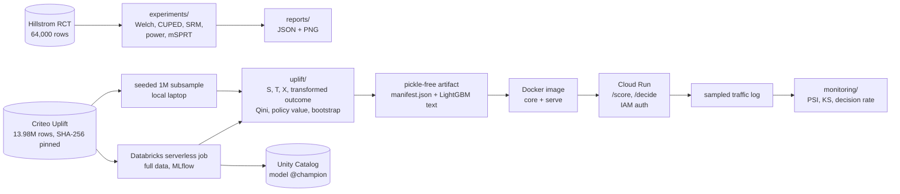

# uplift-experimentation

**Did the campaign work, and whom should we target next time?**

This repo answers the two questions a growth team asks after every campaign, on public randomised data:

1. **Did it work, and how sure are we?** A/B analysis on the Hillstrom e-mail RCT covers effects with
   confidence intervals, CUPED, a sample-ratio-mismatch check, power, and a sequential test that
   stays valid when people peek.
2. **Whom should we target?** Uplift modelling on the 13.98M-row Criteo Uplift RCT uses S-, T- and
   X-learners and a transformed-outcome baseline. They are evaluated with Qini, with bootstrap
   intervals, and with policy value under a contact budget.

The model is trained on the full data on Databricks, served on Cloud Run and monitored for drift.
Every statistical result below comes from a seeded script or job in this repository; its command
and output field are listed in [docs/project-overview-pdr.md](docs/project-overview-pdr.md#evidence).
Latency, image size, cold start and memory are measurements of one deployment, and the library
comparison is a one-off spike: those vary between runs and releases.


| What was checked | Result | Evidence |
|---|---|---|
| Peeking at an A/A test 20 times, 10,000 seeded runs | False positives: naive t-test **24.8%**, mSPRT **0.98%**, single final test 4.99% | `uplift-sequential-report` |
| The price of a peek-safe test | mSPRT needs a cap of **18,000 per arm (1.8x)** to reach the fixed test's 80% power. Under the effect it stops at **11,190 per arm on average, 12% more than the fixed test**; under no effect it runs to 17,848 (near the cap) | `uplift-sequential-report` |
| CUPED on Hillstrom, then on a simulated strong covariate | Hillstrom visit variance **-2.6%**, because pre-period data barely predicts two-week visits. With R² = 0.49 the variance falls **49%** | `uplift-hillstrom-report` |
| Targeting the top 10% by predicted uplift, Criteo, all 13,979,592 rows | **63.7 [60.0, 67.2]** incremental visits per 1,000 contacts with the registered S-learner champion, against 10.3 for treating everyone | [docs/databricks-run.md](docs/databricks-run.md) |
| Drift on simulated shift, scored by the champion | Covariate tilt **alerts**; a 3x label shift **warns** (decision rate 1.46x, just under the 1.5x alert); unshifted traffic stays ok | `uplift-drift-report` |
| Scoring on Cloud Run (IAM-authenticated, max 1 instance), serving the v4 S-learner champion | Server-side p50/p95 **9.0 / 16.1 ms**; image 621 MB | [docs/deployment-guide.md](docs/deployment-guide.md) |
| A model change that hurts targeting | CI fails: the metric gate compares Qini and policy value with a committed baseline on the same bootstrap draws | `uplift-metric-gate` |

---

## How it works



The package is `uplift_lab`. `experiments/` holds the A/B statistics and `uplift/` the learners and
evaluation. `serving/` is the FastAPI app, `monitoring/` the drift checks, `pipelines/` the
full-data job and `gate/` the CI metric gate. [docs/system-architecture.md](docs/system-architecture.md)
has the map and the reasons.

## Results

### Did the campaign work? Hillstrom e-mail RCT

64,000 customers were randomised into Mens e-mail, Womens e-mail and no e-mail. The arms are
balanced: the SRM chi-square p-value is 0.904. Effects are intent-to-treat Welch differences against
no e-mail, with 95% CIs.

| Arm | Outcome | Effect [95% CI] | Relative lift | CUPED variance reduction |
|---|---|---|---|---|
| Mens | visit | +0.0766 [+0.0700, +0.0832] | +72.1% | 2.64% |
| Mens | conversion | +0.0068 [+0.0050, +0.0086] | +118.8% | 0.22% |
| Mens | spend ($) | +0.770 [+0.485, +1.055] | +117.9% | 0.13% |
| Womens | visit | +0.0452 [+0.0389, +0.0516] | +42.6% | 2.36% |
| Womens | conversion | +0.0031 [+0.0015, +0.0047] | +54.3% | 0.16% |
| Womens | spend ($) | +0.424 [+0.169, +0.680] | +65.0% | 0.07% |

**CUPED is barely useful here, and the report says so.** The pre-period covariates are past-year
spend, recency, product lines, newbie and channel. They explain 2.6% of visit variance and under
0.3% for conversion and spend. A 10% relative visit lift needs 13,217 users per arm without CUPED
and 12,873 with it. CUPED agrees with regression adjustment (`y ~ T + X`, HC2) to within 1e-5 for
visit and conversion, and within 1e-4 for spend (under 0.1% of its standard error). The method is
not the problem: the covariates are.

When the pre-period metric does predict the outcome, the seeded contrast shows the effect. Each
line is 1,000 simulated experiments with 2,000 users per arm:

| Covariate correlation ρ | R² | Variance ratio CUPED / raw (theory 1 − ρ²) | CUPED CI coverage |
|---|---|---|---|
| 0.0 | 0.00 | 0.998 (1.00) | 0.948 |
| 0.3 | 0.09 | 0.888 (0.91) | 0.946 |
| 0.5 | 0.25 | 0.796 (0.75) | 0.939 |
| 0.7 | 0.49 | 0.512 (0.51) | 0.957 |
| 0.9 | 0.81 | 0.183 (0.19) | 0.944 |

At ρ = 0.7 the same power needs about half the users. That is the case for CUPED on a metric like
weekly spend with a stable history, not on the two-week visits of a one-off e-mail.

### Peeking: naive t-test against mSPRT

The simulation is Bernoulli with a 10% base rate. Each experiment has 20 looks of 500 users per
arm, a 10,000-per-arm horizon and alpha 0.05, over 10,000 seeded runs per scenario. The A/B effect
is the fixed test's 80%-power MDE (+1.19 points). mSPRT's mixing sd is set to the same value before
any data is seen.

| Rule | False-positive rate (A/A) | Power (A/B) | Median n per arm at rejection |
|---|---|---|---|
| Naive t-test at every look | **0.248** | 0.874 | 3,000 |
| mSPRT (always valid) | **0.0098** | 0.465 | 6,500 |
| One test at the horizon | 0.0499 | 0.787 | 10,000 |

Peeking with a t-test makes a quarter of null experiments "significant". `--large` (100 looks)
raises that to 0.377. mSPRT holds its error rate under any peeking schedule, but it pays for that
in power at a fixed sample size.

**The price of peeking:**
- mSPRT reaches 80% power once the cap is raised to 18,000 per arm, 1.8x the fixed horizon. Its
  false-positive rate at that cap is 0.016.
- It stops as soon as the evidence is strong, but under the alternative it still uses 11,190 per
  arm on average: about 12% more units than the fixed test, not fewer.
- Under the null it rarely stops, so it runs to 17,848 per arm on average (1.78x), close to the
  cap.
- The trade: plan and budget for a larger maximum sample and somewhat more units on average, and
  in exchange look whenever you like without inflating false positives.

### Whom to target? Criteo Uplift, full data on Databricks

The job trained on all 13,979,592 rows: a stratified 70/30 split, LightGBM, 1,000 paired bootstrap
draws. Outcome: visit. Features are `f0`-`f11` only. `exposure` happens after treatment, so it is
rejected as a feature and every effect is intent-to-treat.

| Model | Qini coefficient [95% CI] | Incremental visits per 1,000 contacts, top 10% | Top 30% |
|---|---|---|---|
| **S-learner (champion)** | +0.00314 [+0.00296, +0.00332] | **63.7 [60.0, 67.2]** | 28.7 |
| T-learner | +0.00321 [+0.00302, +0.00339] | 58.3 [54.6, 61.9] | 29.8 |
| X-learner | +0.00313 [+0.00296, +0.00331] | 61.8 [58.1, 65.5] | 28.7 |
| Transformed outcome | +0.00325 [+0.00307, +0.00343] | 62.5 [59.0, 66.2] | 29.5 |
| Random scores | −0.00001 [−0.00013, +0.00013] | 10.9 | 10.3 |
| Treat everyone (ATE) | | 10.3 [9.8, 10.9] | |

- **Every learner beats random.** Each Qini interval excludes 0; random's covers it.
- **Targeting the top 10% yields about six times the incremental visits per contact of treating
  everyone.**
- **No learner wins on visit, so the pre-declared rule picks the S-learner.** The transformed
  outcome has the highest Qini point estimate, but its paired differences against S, T and X all
  cover 0 (Holm-adjusted p 0.35, 0.65, 0.35). Under the champion rule fixed before the run, the
  simplest tied learner is registered and served: the S-learner. It does not depend on a constant
  propensity, while the transformed outcome does, and treatment is slightly predictable (AUC
  0.5105 [0.5098, 0.5113]).
- **Conversion is measurable only on the full data.** Its control arm has about 291 conversions in
  the 1M subsample. On the full data the S-learner is a clear winner even after Holm correction:
  Qini +0.00040 [+0.00035, +0.00045], with every paired difference below 0 (Holm-adjusted p 0.006,
  0.006 and 0.022; the transformed outcome is closest, −0.00004 [−0.00008, −0.00000]). That is
  8.1 [6.9, 9.4] incremental conversions per 1,000 contacts at 10%, against 1.15 for treating
  everyone. The conversion model is evaluated but not registered.

The intervals resample the 4.2M test rows with the fitted models held fixed: they cover test-set
sampling noise, not the variance of retraining.

The local 1M subsample (`uplift-criteo-report`, about 30 s on a laptop, 200 draws) gives the same
picture with intervals about 3.6x wider: S-learner Qini +0.00335 [+0.00273, +0.00404], and 65.1
[51.1, 81.9] per 1,000 contacts at 10%. No learner wins there either, and the same rule picks the
S-learner.

| Databricks run | |
|---|---|
| Job | job run `369767185615309`, serverless, Free Edition, asset bundle in [`databricks.yml`](databricks.yml), commit `4238f32` (clean tree) |
| Rows | 13,979,592 (9,785,714 train / 4,193,878 test), source SHA-256 checked on the Volume |
| Script time | 3,756 s (62.6 min) for both outcomes, all four learners and 2 x 1,000 bootstrap draws |
| Reproducibility | Every point estimate (175 per outcome) equals the earlier 200-draw run `286670365587179` exactly |
| Registry | `workspace.uplift_lab.uplift_criteo_visit` v4 (S-learner), alias `champion`; v2 (transformed outcome, earlier run) kept |

### Serving

`POST /score` returns the uplift per customer. `POST /decide` returns treat or skip under a named
budget (the manifest's 10/20/30/50% thresholds) or under a share of the batch. Rows must carry
exactly `f0`-`f11` as JSON numbers (a boolean or a numeric string is a 422, not coerced).
`treatment`, `exposure` and outcome fields are rejected with 422, and batches are capped at 1,000
rows.

These are measurements taken on 2026-11-01. The Cloud Run rows come from the live service, which
serves the v4 S-learner champion (revision `uplift-serve-00002-97f`). The container rows come from
an earlier export baked into a local image. The S-learner runs its one booster twice per row, once
as treated and once as control.

| Measurement | Result |
|---|---|
| Cloud Run, `asia-southeast1`, server-side request latency (400 `/score` calls, batch 1 and 100) | p50 9.0 ms, p95 16.1 ms |
| Same calls measured at a client in Vietnam | p50 74 ms (mostly the network round trip to Singapore) |
| Inside the container (earlier export), `/score` batch 1 / batch 100 | p50 1.17 / 2.16 ms |
| Image, uncompressed / compressed | 621 MB / 143 MB (from 1.01 GB, once the analysis stack left the image) |
| Cold start, `docker run` to a healthy `/health` (local) | 1.22 s |
| Memory after a 1,600-request benchmark | 84 MiB |

The live service requires an identity token, and an anonymous call gets 403:

```bash
URL=$(gcloud run services describe uplift-serve --region=asia-southeast1 --format='value(status.url)')
curl -H "Authorization: Bearer $(gcloud auth print-identity-token)" -H "Content-Type: application/json" \
  -d '{"budget": "0.1", "customers": [{"id": "c1", "f0": 12.6, "f1": 10.1, "f2": 8.5, "f3": 4.2,
       "f4": 10.3, "f5": 4.1, "f6": -1.4, "f7": 4.8, "f8": 3.9, "f9": 13.2, "f10": 5.3, "f11": -0.2}]}' \
  "$URL/decide"
```

### Drift monitoring

`uplift-drift-report` compares traffic with the training reference:
- a PSI on reference deciles for every feature and for the uplift score (warn at 0.1, alert at 0.2);
- a KS test with a Bonferroni correction over the 13 tested columns (12 features and the uplift
  score), reported but never alerting on its own;
- the **decision rate**: the share of traffic above the 10%-budget threshold, divided by 10%. It
  warns outside [0.75x, 1.33x] and alerts outside [0.5x, 1.5x].

The scenarios below are seeded resamples of 300,000 held-out rows of the 1M subsample, 50,000 per
scenario, scored by the registered champion (the v4 full-data S-learner, the model being served)
with its manifest's 10%-budget threshold:

| Scenario | Status | PSI-flagged features | Uplift-score PSI | KS-rejected features (of 12) | Treat rate at the 10% budget |
|---|---|---|---|---|---|
| No shift | ok | none | 0.000 | 0 | 0.098 (0.98x) |
| Covariate tilt to high `f0`, `f6` | **alert** | f0 (0.203), f6 (0.201) | 0.162 (warn) | 10 | 0.041 (0.41x, alert) |
| Treatment mix 50/50 | ok | none | 0.001 | 0 | 0.094 (0.94x) |
| Visit rate 4.7% to 13.9% (label shift) | **warn** | none | 0.025 | 11 | 0.146 (1.46x, warn) |

PSI misses the label shift. Criteo features have large point masses, so they get few bins. The
decision rate flags it, because a 10% budget would have treated 14.6% of traffic, but with this
model only as a warning: 1.46x sits just under the 1.5x alert bound. (The earlier subsample
S-learner reached 1.53x and alerted.) The covariate alert is also thin: f0 and f6 sit just above
0.2. The no-shift row is a sanity check rather than an independent test: it resamples held-out
rows, and the subsample's held-out rows can overlap the full-data model's training rows.

### What CI enforces

| Job | Fails when |
|---|---|
| `lint-and-types`, `tests` (Python 3.11 and 3.13) | ruff, ruff format, mypy strict or any of the 199 tests fail. The statistical tests check: Welch CI coverage; CUPED unbiasedness and its 1 − ρ² variance ratio; mSPRT type-I error under the null; mSPRT against numerical integration; power against statsmodels; the API's leakage and validation rules |
| `drift-report` | Synthetic unshifted traffic is not `ok`, or the covariate shift does not `alert`. The HTML report is uploaded as an artifact |
| `metric-gate` | Any learner's Qini or 10%-budget policy value drops against [the committed baseline](evals/metric-gate-baseline.json) by more than the test set's sampling noise (paired interval below 0) and by more than 2%, or its Qini interval stops excluding 0 |

The metric gate trains all four learners on a seeded 100,000-row synthetic RCT (about 4.5 s, no
download). Baseline Qini: S +0.0146 [0.0122, 0.0166], T +0.0127, X +0.0134, transformed outcome
+0.0115. The baseline stores every bootstrap draw. The draws are seeded, so draw *b* of a new run
resamples the same test rows as draw *b* of the baseline, and the gate bootstraps the
head-minus-baseline difference pairwise. That is much tighter than the baseline's own interval: on
seeded probes it fails a learning rate of 0.2 or 63 leaves, which the baseline interval let pass.
The 2% floor keeps a consistent but negligible shift, such as a platform-level difference in one
split, from failing the build. The fingerprint includes the LightGBM, numpy, pandas and
scikit-learn versions, and the CI job installs the pinned set in
[`evals/metric-gate-constraints.txt`](evals/metric-gate-constraints.txt). The tests show that it
fails a model trained without the effect-driving feature, and that it refuses a baseline built on
other data, settings or library versions. Refresh the baseline in the same pull request with
`uplift-metric-gate --update-baseline`.

## Design decisions and trade-offs

- **In-house learners, metrics and drift checks instead of causalml, scikit-uplift or Evidently.**
  A spike compared them on Python 3.12 and 3.14:
  - causalml shipped wheels for cp311/cp312 only, which would have blocked the 3.13 CI leg.
  - scikit-uplift was last released in 2022 and calls a function removed in scikit-learn 1.10.
  - Evidently failed to import with pandas 3.

  The in-house S/T/X code matched causalml and scikit-uplift to four decimals in that spike. It is
  about 200 lines on LightGBM, with recovery tests on synthetic data with a known effect and
  frozen-prediction regression tests on a seeded fit.
- **Intent-to-treat.** Criteo's `exposure` is post-treatment: 3.6% of treated users. It is
  rejected as a feature at training, at artifact load and at the API, so every effect is the effect
  of being assigned to treatment.
- **Randomisation is checked rather than assumed.** A LightGBM model predicts treatment from the
  features with held-out AUC 0.5105 [0.5098, 0.5112] on the full data. Assignment is slightly
  predictable, consistent with Criteo pooling several tests. This biases inverse propensity
  weighting with one constant propensity. The headline policy value therefore uses the
  within-segment difference in means, which adapts to each segment's own treated share and is less
  biased than constant-propensity IPW (still not unbiased if the share varies inside a segment;
  AIPW or propensity strata are on the roadmap). Constant-propensity IPW stays a secondary column.
  S and T are fit on outcomes and never use the propensity; X uses it only as a blending weight.
- **No winner without a paired test, and a champion rule fixed in advance.** Point estimates rank
  the learners differently on the subsample and on the full data. The report names a winner only
  when every paired Qini difference against the best is significant after Holm correction. The
  registered and served model follows a rule written before the run (`uplift/champion.py`): the
  clear winner if there is one, otherwise the first learner not significantly worse than the
  best in the order S > T > X > transformed outcome, simplest and least propensity-sensitive
  first. The rule and its reason are recorded in the manifest and the MLflow tags.
- **What the intervals cover.** The bootstrap resamples the test set with the fitted models held
  fixed. The intervals measure test-set sampling noise, not the variance of retraining on another
  sample.
- **A pickle-free model artifact.** `manifest.json` (schema version, features, propensity, budget
  thresholds, checksums, git SHA) plus LightGBM text files. Loading needs numpy, pandas and
  LightGBM, and never unpickles. The MLflow pyfunc and the Unity Catalog model wrap the same
  directory and carry the package source, so they load in a clean environment from their
  `requirements.txt` alone.
- **A slim image.** The package core is what scoring needs; training and reports sit in the
  `analysis` extra. Lazy re-exports keep scikit-learn, statsmodels and pyarrow off the serving
  import path, and a test enforces it. The result is 1.01 GB to 621 MB and a 2.1 s to 1.2 s cold
  start.
- **Authentication on Cloud Run.** `--no-allow-unauthenticated`, a dedicated runtime service
  account with no roles, `max-instances=1` as the spending cap, and the project's existing budget
  alert. The model is trained on non-commercial data, and IAM keeps it from becoming a free public
  scoring API.
- **An in-house metric gate, not regressgate.** [regressgate](https://github.com/tantn89/regressgate)
  gates stochastic pass/fail eval trials with permutation and Fisher tests. This pipeline is
  deterministic and its metrics are continuous, so the gate bootstraps the head-minus-baseline
  difference on the same seeded draws.

## Run it locally

No account or paid key is needed. The datasets download on first use, checked against pinned SHA-256
values (Criteo is 311 MB).

```bash
python -m pip install -e ".[dev]"   # Python 3.11+
uplift-hillstrom-report             # A/B effects, CUPED, SRM, power -> reports/hillstrom
uplift-sequential-report            # peeking simulation and the price of peeking -> reports/sequential
uplift-criteo-report                # uplift on the seeded 1M Criteo subsample -> reports/criteo-uplift
uplift-metric-gate                  # the CI metric gate against evals/metric-gate-baseline.json
```

Then `pytest` runs the suite (199 tests, about 40 s). See also:
- [docs/deployment-guide.md](docs/deployment-guide.md): the service, the Docker image and the
  Cloud Run commands.
- [docs/databricks-run.md](docs/databricks-run.md): the full-data job.
- [docs/codebase-summary.md](docs/codebase-summary.md): every CLI, including `uplift-drift-report`,
  `--mlflow` and the full-data pipeline.

## Datasets and licences

Nothing is committed or redistributed. Data downloads into a per-user cache (`UPLIFT_LAB_CACHE`
overrides it) and is checked against a pinned checksum.

| Dataset | Source | Licence |
|---|---|---|
| Hillstrom MineThatData E-Mail Analytics (64,000 rows) | [minethatdata.com](http://www.minethatdata.com/Kevin_Hillstrom_MineThatData_E-MailAnalytics_DataMiningChallenge_2008.03.20.csv) (HTTP only; integrity from the SHA-256 pin) | Published by Kevin Hillstrom for the 2008 challenge; no formal licence |
| Criteo Uplift Prediction v2.1 (13,979,592 rows) | [huggingface.co/datasets/criteo/criteo-uplift](https://huggingface.co/datasets/criteo/criteo-uplift), pinned revision | [CC BY-NC-SA 4.0](https://creativecommons.org/licenses/by-nc-sa/4.0/) |

Criteo data: Diemert, Betlei, Renaudin and Amini, *A Large Scale Benchmark for Uplift Modeling*,
AdKDD 2018. Use is non-commercial. Even a subsample would count as an adaptation under NC-SA, so the
repository ships code only.

## Roadmap

- An AIPW (doubly robust) policy estimate using the fitted propensity, given AUC 0.51, and a
  propensity-stratified check of the within-segment estimate.
- A decision-rate alert on served traffic as a scheduled job, rather than an on-demand report.
- Exposing scored segments to agents through [warehouse-mcp](https://github.com/tantn89/warehouse-mcp).

The full list, and what is out of scope, is in [docs/project-roadmap.md](docs/project-roadmap.md).

## Contact

Telegram [@tanngoctr](https://t.me/tanngoctr).

## Licence

Code: MIT. Data: see the table above.
