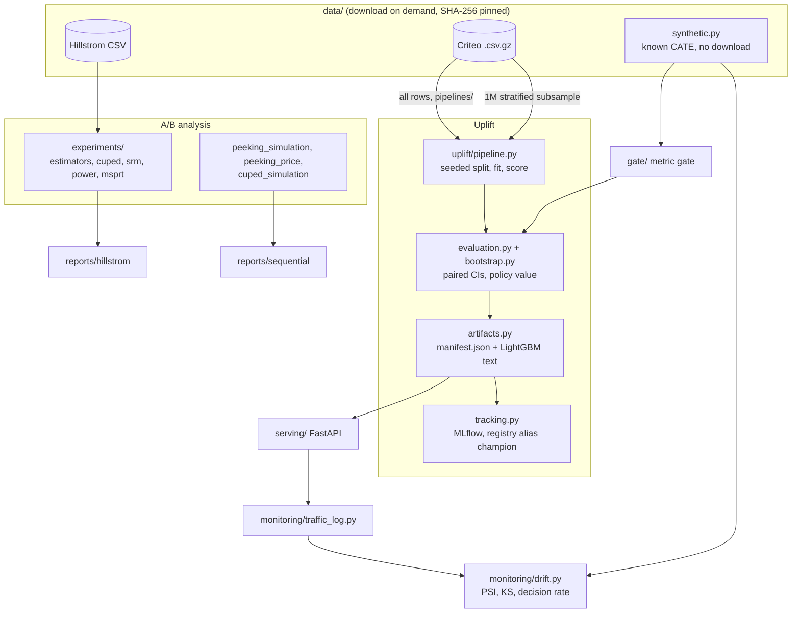

# System architecture

Code owns the mechanics; this page owns the map and the reasons. Module paths are relative to
`src/uplift_lab/`.

## Flows

| Flow | Entry point | Runs where |
|---|---|---|
| Hillstrom A/B report | `reports/hillstrom.py` (`uplift-hillstrom-report`) | Laptop |
| Peeking simulation and price of peeking | `reports/sequential.py` (`uplift-sequential-report`) | Laptop |
| Criteo uplift on the 1M subsample | `reports/criteo_uplift.py` (`uplift-criteo-report`) | Laptop |
| Criteo uplift on all rows | `pipelines/criteo_full_training.py` via `databricks/train_criteo_full.py` | Databricks serverless job, or laptop |
| Scoring | `serving/app.py` (`create_app`) | Docker image on Cloud Run |
| Drift report | `reports/drift.py` (`uplift-drift-report`) | Laptop and CI (synthetic) |
| Metric gate | `gate/cli.py` (`uplift-metric-gate`) | CI and laptop |

## Statistical design

**Estimand.** Every effect is intent-to-treat: the effect of being assigned to treatment.
Criteo's `exposure` is recorded after assignment. `uplift/features.py` rejects it, along with
`treatment` and the outcomes, as a model input. The same guard runs at artifact load and in the API
schema.

**A/B inference.** The A/B estimator is a Welch difference in means with Satterthwaite degrees of
freedom; the relative-lift CI uses the delta method. CUPED uses a pooled `theta = Cov(X)^-1 Cov(X, y)`,
and its covariates are only those measured before the campaign. Regression adjustment is reported
as a check. Power uses the normal closed form with a CUPED variance factor `1 - R^2`.

**Sequential testing.** The test is Johari et al.'s normal-mixture mSPRT. The mixing sd `tau` is
the design MDE, fixed before the data. Validity holds for any `tau`, which only moves power. The
simulation draws per-look binomial counts, so its cost is O(runs x looks), and scores all three
rules on the same data. The fixed-horizon rule reproduces alpha and the target power, which
calibrates the simulation. The price of peeking reuses one long simulation: an mSPRT decision at a
look never depends on later data, so the share of runs rejected by look k is mSPRT's power under a
cap at look k.

**Uplift evaluation.** Curves are per population user, against the targeted fraction. Ties are
evaluated at the ends of tie groups, so results do not depend on row order. The bootstrap is
expressed as multiplicity weights over one precomputed sort per model. Every statistic in a draw
therefore sees the same resample, which makes the differences between models paired. Policy value
is the within-segment difference in means (Hajek). Horvitz-Thompson IPW with a constant propensity
is kept as a secondary column, because treatment is slightly predictable from the features: AUC
0.5105 [0.5098, 0.5112] on the full data. This is checked by `uplift/propensity.py`.

**Drift.** PSI uses the unique reference deciles, right-closed bins and an epsilon floor. KS is
scipy's two-sample test with a Bonferroni correction; it is reported but never alerts alone. The
decision rate is the share of traffic at or above the 10%-budget score threshold, divided by the
budget. It is the operational signal: it caught the simulated label shift that PSI missed. A
scenario's status is the worst over features, prediction and decision rate.

**Metric gate.** The data (a seeded synthetic RCT with a known effect) and the evaluation settings
are fingerprinted. The frame hash is taken after rounding to 9 decimals, because numpy's normal
sampler calls libm in its tail and one value in 10^5 differed in the last bit between Windows and
Linux. Model settings are not fingerprinted; they are what the gate judges. The rules:
- a regression is a head estimate below the baseline's lower 95% bootstrap bound;
- a Qini interval that no longer excludes 0 fails;
- an estimate above the upper bound is an improvement and passes.

## Model artifact and serving

The serving contract is a directory: `manifest.json` (format `uplift-lab.uplift-model`, schema
version 1, kind, ordered features, propensity, booster file names, metadata with budget thresholds,
checksums and git SHA) plus one LightGBM text model per component. `load_learner` validates the
manifest, refuses path traversal in file names and re-applies the leakage guard. It never unpickles.
The MLflow pyfunc is logged as models-from-code and wraps the same directory. The service can
resolve a registry URI with `mlflow-skinny`, but by default the model is baked into the image:
- no registry credentials at runtime;
- no network at startup;
- rollback is redeploying the previous image tag.

Request path: pydantic schema (exactly `f0`-`f11`, finite, `extra="forbid"`, a leakage 422 for
post-treatment fields, at most 1,000 rows), then `ModelService` (score, or decide by manifest
threshold or batch share). After that, an optional sampled traffic log, which records no ids. A
custom validation handler drops `input` and `ctx` from 422 bodies, so errors never echo customer
data. It also fixed a 500 that a JSON `NaN` caused in FastAPI's default handler.

## Why the dependencies look like this

| Choice | Alternatives | Reason |
|---|---|---|
| In-house S/T/X/transformed outcome on LightGBM | causalml, scikit-uplift | At the 2026-11-01 spike, causalml had cp311/cp312 wheels only, and scikit-uplift (last release 2022) calls a helper removed in scikit-learn 1.10. The in-house code matched both to four decimals |
| In-house PSI and KS | Evidently | Evidently 0.7.23 failed to import with pandas 3 and added about 200 MB; the PSI the design needs is a few lines |
| In-house metric gate | regressgate | regressgate gates stochastic pass/fail trials with permutation and Fisher tests. This pipeline is deterministic, with continuous metrics, so the rule uses the baseline's own bootstrap interval |
| Core = numpy, pandas, LightGBM, platformdirs | One dependency list | The serving image skips the `analysis` extra (pyarrow, scikit-learn, statsmodels): 1.01 GB to 621 MB, cold start 2.1 s to 1.2 s |
| sqlite MLflow store locally | `./mlruns` file store | MLflow 3.17 refuses the plain file store by default |
| Hugging Face Criteo mirror at a pinned revision | go.criteo.net | The official links returned 404 at the spike |

## Trust boundaries and cost

- **Cloud Run.** The service runs with `--no-allow-unauthenticated` and a dedicated service account
  with no project roles. `max-instances=1` and `min-instances=0` cap spend; the existing project
  budget alerts. See [deployment-guide.md](deployment-guide.md).
- **Databricks Free Edition.** The job runs serverless with no billing. The source file on the
  Volume is checked (size, then SHA-256) before parsing. See [databricks-run.md](databricks-run.md).
- **Data licences.** No dataset or derived subsample is committed. The image contains the trained
  model only, and the pyfunc input example is a synthetic all-zero row, not a Criteo row.
